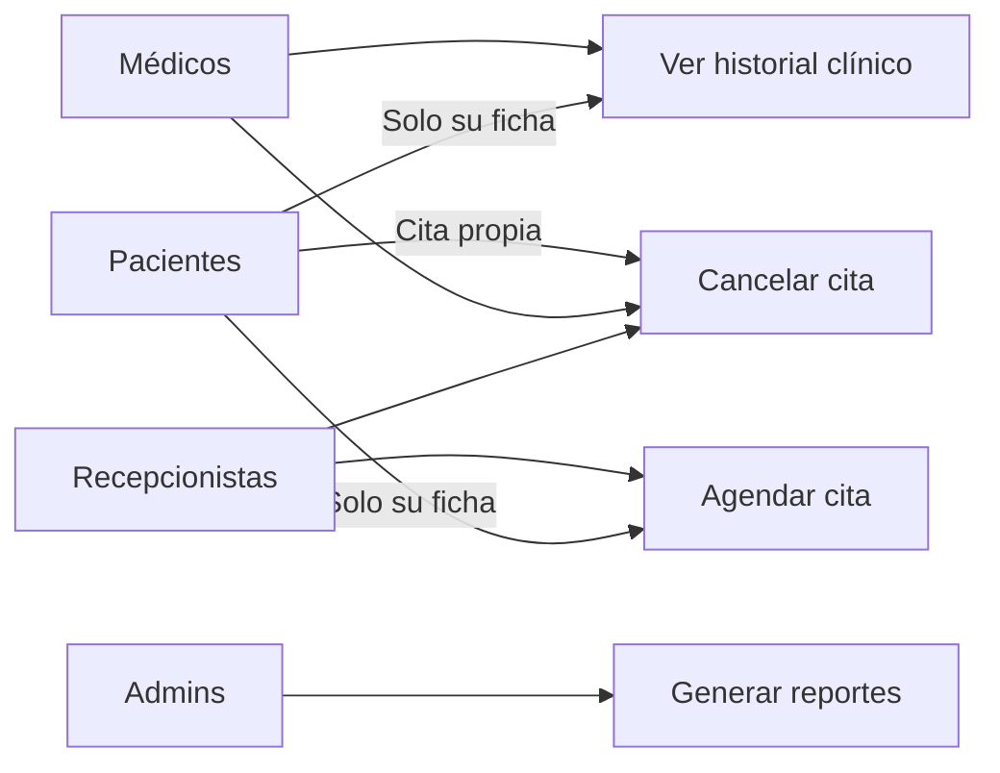

# Consultas médicas · Caso 2

Práctica grupal de Desarrollo de Aplicaciones Web. Centro Médico Universitario · UNCP. Este avance cubre el portal de acceso, las políticas por rol, la bitácora y el middleware. Los formularios, modelos y datos del dominio se integrarán en colaboración con Zair.

## Puesta en marcha

Desde PowerShell con Python 3.12 o posterior:

```powershell
python -m venv .venv
.\.venv\Scripts\python.exe -m pip install -r requirements.txt
.\.venv\Scripts\python.exe manage.py migrate
.\.venv\Scripts\python.exe manage.py configurar_roles
.\.venv\Scripts\python.exe manage.py cuenta_prueba demo-paciente paciente
.\.venv\Scripts\python.exe manage.py cuenta_prueba demo-admin admin
.\.venv\Scripts\python.exe manage.py runserver
```

Cada cuenta requiere una contraseña temporal. Abre http://127.0.0.1:8000/ e ingresa con `demo-paciente@uncp.edu.pe` o `demo-admin@uncp.edu.pe`. El portal usa usuarios locales de Django con ese dominio. Las cuentas de prueba y SQLite están pensadas para datos ficticios.

La cookie `consultas_sesion` usa `HttpOnly` y `SameSite=Lax` y dura **20 minutos de inactividad**. Para HTTPS, configura `DJANGO_DEBUG=0`, `DJANGO_SECRET_KEY` y `DJANGO_ALLOWED_HOSTS`. Django exigirá HTTPS y marcará las cookies de sesión y CSRF como `Secure`.

Como paciente, abre `/auditoria/` para reproducir un 403. Ingresa como admin para ver el evento en el portal o en Django Admin.

## Permisos por rol

| Acción | Médico | Recepción | Paciente | Admin |
| --- | --- | --- | --- | --- |
| Ver historial clínico | Sí | — | Propio | — |
| Agendar cita | — | Sí | Propia | — |
| Cancelar cita | Sí | Sí | Propia | — |
| Generar reportes | — | — | — | Sí |



## Integración con el dominio

- Cada paciente y médico se vincula con un usuario de Django. Para agendar o cancelar, llama a `agendar_cita(usuario, paciente.usuario_id)` o `cancelar_cita(usuario, cita.paciente.usuario_id)` inmediatamente antes de guardar. Resuelve el titular desde la base de datos. Para la agenda del médico, filtra por su perfil vinculado a `request.user`. Para reportes usa `generar_reportes(usuario)`.
- En la vista del historial, llama a `marcar_acceso_historial(request, paciente.usuario_id, historial_id)` antes de acceder al contenido y usa `@never_cache`. El middleware guarda el acceso si la respuesta tiene estado 2xx. La auditoría conserva el identificador, la cuenta, la fecha y la IP. Aplica el mismo control a cualquier acceso por Admin.
- En el POST de agendamiento, usa `@controla_horario(validador)`. La función recibe `request` y parámetros de URL, comprueba el permiso y llama a `validar_horario_cita(fecha_hora)` con una fecha consciente de zona. La ventana en Lima es lunes a viernes de 08:00 a 18:00 y sábado de 08:00 a 13:00. Se admite la apertura y se excluye la hora de cierre. Conserva la validación de cruces y disponibilidad en el formulario y en la transacción del dominio.
- Configura `DJANGO_AVISOS_INGRESO=consultas.avisos.avisos_ingreso` cuando exista esa función. Recibe `usuario, ahora`, filtra las citas pendientes del médico autenticado y devuelve `citas_pendientes(usuario, queryset)`.
- Registra los cambios de citas y consultas con `auditar_operacion(request, accion, tipo, objeto_id)` dentro de la transacción que guarda la operación. Usa identificadores internos y conserva el contenido clínico en sus tablas.
- Si se incluyen `consultas:reportes`, `consultas:agenda`, `consultas:agendar_cita` y `consultas:mis_citas`, aparecen los enlaces correspondientes al rol en **Mi cuenta**.

`configurar_roles` crea los grupos del caso. Cuando se declaren y migren permisos de modelos del dominio, lista sus nombres en `PERMISOS_GRUPOS` por rol, en formato `app.modelo.codename`, y vuelve a ejecutar el comando. Los controles de propiedad y área siempre se aplican sobre los objetos del servidor.

## Pruebas

```powershell
.\.venv\Scripts\python.exe manage.py test
.\.venv\Scripts\python.exe manage.py makemigrations --check --dry-run
```
